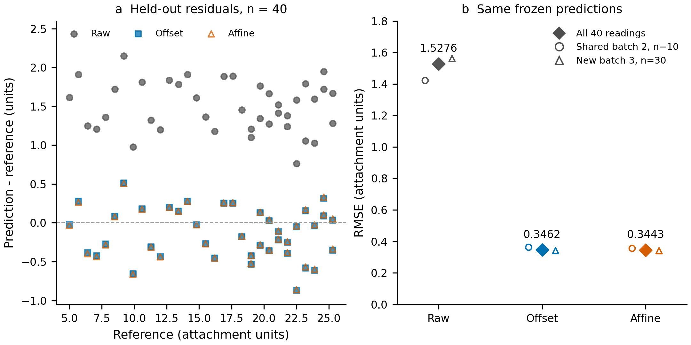

# 偏移修正是否足够？冻结划分合成测量数据中的校准复杂度演示

> 已完成本次同宿主快速全稿专业复核的教学演示稿；非真实研究、非原创科学发现。作者确认、人类来源核验及独立同行评审未完成；不宣称投稿就绪。

## 摘要
本演示比较固定偏移与线性预测校准。附件共120条人为合成读数，80条用于训练、40条用于冻结测试。训练内按3个批次留一验证，并在测试评价前锁定模型和0.05单位的教学增益阈值。训练验证RMSE为偏移0.3588、线性0.3628，规则选择偏移。测试RMSE由未校准1.5276降至偏移0.3462；线性为0.3443，额外改善0.0020，低于约定阈值（约为偏移RMSE的0.56%）。敏感性与完整复算支持数值结果，但只有2个测试批次，不能据此证明总体等效。在这份数据和既定教学阈值下，不需要增加斜率参数；这不是两模型总体等效的证明。

## 引言
校准复杂度应由有公平基线的留出表现判断。固定偏移对应加性误差解释，线性校准允许比例误差；二者还可能受到批次扰动、噪声及范围差异影响。最小二乘是成熟方法，存在异常点敏感性和外推局限。本稿的缺口只是这份附件中复杂度收益尚未量化，没有领域首创或实际仪器需求的主张。

## 方法
reference作为预测目标，sensor作为输入，单位仅称“附件单位”。batch0训练30条、batch1训练30条、batch2训练20条/测试10条、batch3测试30条；没有删除读数、插补或改变原分区。因此测试包含一个共享批次和一个未见批次，不能概括为充分的外部批次验证。

比较raw=sensor、offset=sensor+d和affine=a+b·sensor。参数只用训练集拟合：d为reference-sensor均值，a/b用NumPy2.0.2的lstsq。训练留一批次验证每折重新拟合，以汇总RMSE比较；只有线性改善至少0.05才增加参数。该阈值预先选作教学规则，不代表物理效用。数据哈希和计划在测试指标计算前保存；脚本先写model-lock再评价测试。

主要终点RMSE，次要MAE和bias（预测减参考）。稳健性包括批次分层、按训练reference中位数14.1分低高区间、训练中位数偏移、删除最大训练残差后的影响点重拟合。测试2批次bootstrap10000次（seed=20261012）只作已拟合参数条件下的描述；4种符号翻转也不作有效随机化/总体推断。完整复算输出另存目录，闭式OLS与lstsq独立对照。

分析中曾误把4个总批次写成4个训练/测试共同批次。逐组计数纠正为3训练/2测试批次；动态CV计算本来正确，正式拟合共8次。原错误及修订保留在evidence/analysis-amendment.md；主模型、终点、阈值及测试分区没有改变。

## 结果
训练偏移参数d=-1.634527；线性参数a=-1.656142、b=1.001359。训练验证线性较偏移RMSE恶化0.004006，故冻结选择偏移。测试结果见表1；偏移减少主要加性误差，仍有bias=-0.140118。线性的额外RMSE收益为0.001952。

表1　同一冻结测试集的校准表现，n=40；单位均为附件单位。

|模型|RMSE|MAE|bias|
|---|---:|---:|---:|
|未校准|1.5276|1.4944|1.4944|
|偏移|0.3462|0.2871|-0.1401|
|线性|0.3443|0.2861|-0.1367|

共享batch2(n=10)的线性RMSE增益为0.006866；未见batch3(n=30)为0.000227。低参考区间(n=14)的线性RMSE为0.345009，差于偏移0.342701；高区间(n=26)线性为0.343898，优于偏移0.348129。中位数偏移RMSE=0.348702，删最大训练残差后偏移/线性=0.350880/0.350019。两批次bootstrap描述分位范围0.000227–0.006866，不称为可靠总体置信区间。

闭式OLS与lstsq最大系数差1.78×10⁻¹⁵；完整复算的5个主要数值/配置/CSV文件SHA256完全相同。主要计算约0.0076秒；稳健性含完整复算约0.301秒。实测成本允许增加旧代理草案的两次拟合估计，不改变用户硬预算。

图1　a展示全部40条留出读数的原量纲误差；b的实心菱形是40条读数的聚合RMSE，空心圆/三角是共享batch2与未见batch3。没有置信误差棒或显著性星号；形状和彩色冗余编码，灰度版另附。图中近重叠的校准散点反映真实小差异。

## 讨论与结论
证据支持本附件中主要改善来自偏移，增加斜率的测试收益低于教学阈值，且训练验证、参考量级敏感性没有显示稳定必要性。因此按冻结规则选择偏移。这个零收益决策不等于证明两模型统计等效，也不说明线性校准在其他仪器或范围无效。残余偏差、单一未见批次、未知数据生成机制、合成来源和任意教学阈值限制推广。下一项真实验证需要预先定义物理效用并增加独立实测批次；本演示没有完成这些工作。

## 透明性与参考资料
先前演示由Codex执行代码、结果整理与绘图；本次依据已有材料完成写作、数字核查和同宿主快速全稿专业复核，未重新拟合；没有独立同行评审或人类作者确认。未发表、未投稿，资金/利益冲突及真实作者身份未提供，保持未核验。代码、输入、冻结配置与复算结果在本项目本地交付。K-Dense流程的使用在软件致谢中披露，相关预印本身份已核查、未全文阅读。

1. NIST/SEMATECH. [Linear Least Squares Regression](https://www.itl.nist.gov/div898/handbook/pmd/section1/pmd141.htm)，方法定义与局限。
2. NumPy Developers. [numpy.linalg.lstsq, v2.0 Manual](https://numpy.org/doc/2.0/reference/generated/numpy.linalg.lstsq.html)，接口与目标函数。
3. Kassis T, Agarwal V, He Y, Patel D, Brueckner AM. Scientific Agent Skills: A Library of Procedural Knowledge for Research Agents. 2026. [arXiv DOI](https://doi.org/10.48550/arXiv.2609.00065)，仅软件/流程致谢；身份记录v2，2026-09-02。
