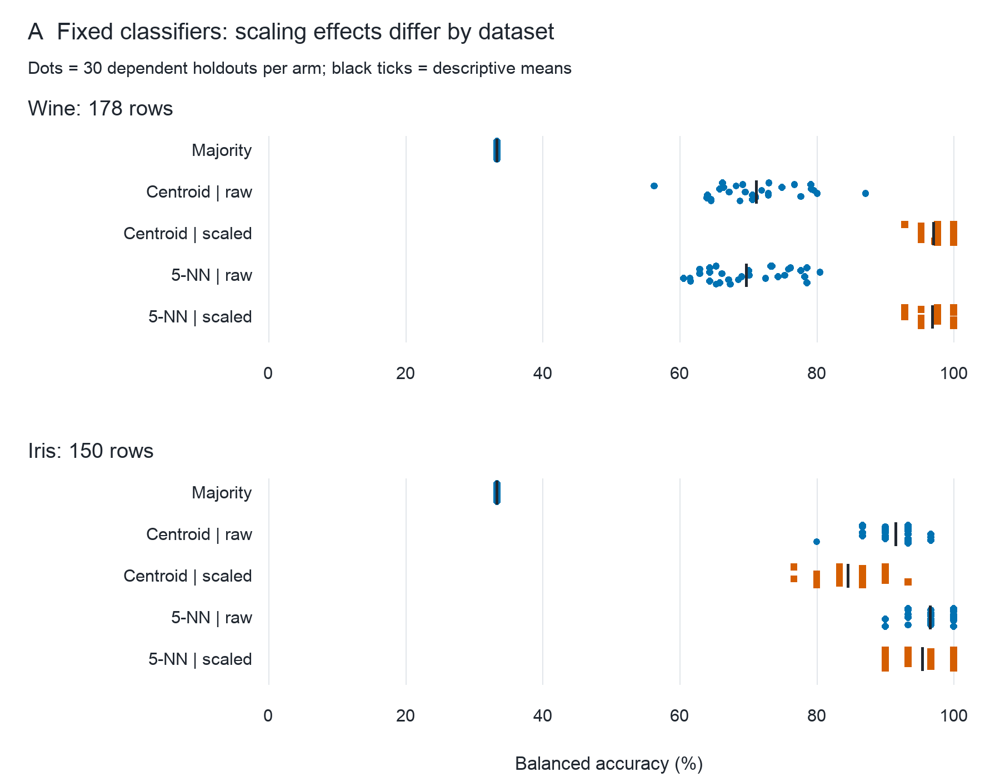
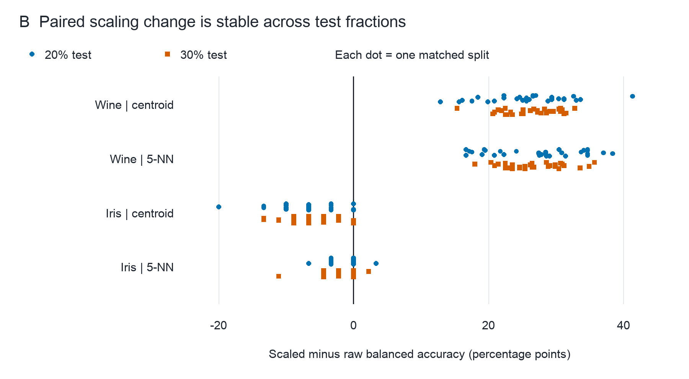

# Training-only standardization and fixed distance classifiers: a reproducible Wine and Iris teaching reanalysis

Completed empirical teaching report · 13 October 2026 · Agent-assisted, human source verification and submission approval unverified

## Abstract

We compared fixed unscaled and training-standardized nearest-centroid and five-nearest-neighbor classifiers, with a majority reference, on the complete original UCI Wine and Iris tables. The design preceded acquisition and model fitting. Thirty matched stratified 80/20 holdouts per dataset were analyzed descriptively, followed by prespecified 70/30 sensitivity and deterministic replay. Scaling raised Wine mean balanced accuracy by 25.82 percentage points for centroid and 27.16 points for 5-NN, but reduced Iris means by 7.00 and 1.11 points. The mean directions persisted at the second test fraction. All 600 main/sensitivity metric rows were independently recomputed; four replay outputs were byte-identical. These dependent historical-data comparisons illustrate dataset-specific preprocessing behavior and an auditable research workflow, without claiming a new method, statistical population inference or universal algorithm superiority.

## Introduction

Feature standardization changes the distances used by simple classifiers. Its empirical consequences depend on the data representation and decision rule; a claim of improvement should therefore name the actual data and protocol. The Wine dictionary specifically suggests standardization for non-scale-invariant classifiers [1]. Separately, official scikit-learn guidance explains why learned preprocessing must be fitted using training information only [3]. This study asks how fixed training-only standardization changes two simple distance rules on the complete original Wine and Iris versions. It supplies a teaching replication, not a claim that these established datasets or algorithms constitute a new research gap.

## Methods

The scientific design was locked in research-plan-v1.md before acquisition or fitting. An ensuing version repaired missing procedural-support references and retained the same hypotheses, data scope, five fixed arms, seeds and metrics. Both UCI datasets were then linked to the repaired execution plan, without redownloading or changing their bytes. There was no protocol registration or human approval claim.

The official UCI static archives were retrieved on 13 October 2026. Selected extraction retained complete wine.data and iris.data plus their dictionaries; no data-pool crawl or bundled sklearn copy was used. Wine contains 178 records with 13 chemical measurements and class counts 59, 71 and 48 [1]. Iris contains 150 records with four measurements in cm and 50 records in each class [2]. The original iris.data version was retained despite documented historical discrepancies in rows 35 and 38. Downloaded archives totaled 9,776 bytes; ZIP checks and full local parsing passed. Whole-table preparation found no missing or nonfinite feature cells. There were no duplicate Wine feature vectors and three excess duplicate Iris feature rows. No record or outlier was removed, and no feature value was imputed. Wine units absent from the dictionary remain unspecified.

For each dataset and seed 0 through 29, NumPy default_rng independently permuted row indices within each class. The test set took max(1, round(f*n_class)) observations from each permuted class and training took the remainder, with f=0.2 for the main analysis and f=0.3 for sensitivity. All arms shared each exact split. Main training/test counts were 142/36 for Wine and 120/30 for Iris; sensitivity counts were 125/53 and 105/45. These are row-stratified internal holdouts, not independent prospective or external validation samples. The source lacks identifiers that would establish independent biological sampling; duplicate-vector overlap is recorded per split.

The fixed arms were a training-majority predictor, nearest centroid with raw features, nearest centroid with standardized features, Euclidean 5-NN with raw features and Euclidean 5-NN with standardized features. Standardization used z=(x-training_mean)/training_population_SD; zero SD was mapped to 1. Centroids were training class means, and nearest neighbors used uniform votes. Tied labels favored the lowest encoded class; tied distances favored lower original row indices. Hyperparameters, seeds and model families were not tuned against test outcomes. A ten-fit pilot checked implementation before the full experiment and did not change the design.

Balanced accuracy, the mean of the three class recalls, was primary; ordinary accuracy was secondary. We report mean performance, observed split standard deviation and matched standardized-minus-raw differences. Because repeated holdouts reuse observations, their standard deviations characterize partition variation rather than independent-sample standard errors or confidence intervals. No p-values were computed. The NumPy implementation ran locally under Python 3.12.14 and NumPy 2.3.5; it does not depend on sklearn. Saved predictions, confusion matrices, split indices and training scaler parameters support reproduction.

## Results

Table 1 reports every fixed arm on the 30 main partitions for each dataset. Standardized centroid and standardized 5-NN had Wine mean balanced accuracies of 97.05% and 96.90%, compared with 71.23% and 69.75% for their raw counterparts. Mean matched improvements were 25.82 and 27.16 percentage points; every Wine partition showed a positive difference for each family. On Iris, centroid decreased from 91.56% to 84.56% and 5-NN from 96.56% to 95.44%, giving mean differences of -7.00 and -1.11 points. Iris centroid had 26 negative and four zero splits; Iris 5-NN had ten negative, nineteen zero and one positive split. The majority reference had balanced accuracy 33.33% on both datasets.

| Dataset | Fixed method | Mean balanced accuracy (%) | Split SD (pp) | Mean accuracy (%) |
|---|---|---:|---:|---:|
| Wine | Majority | 33.33 | 0.00 | 38.89 |
| Wine | Centroid, raw | 71.23 | 6.32 | 71.67 |
| Wine | Centroid, train-scaled | 97.05 | 1.84 | 96.57 |
| Wine | 5-NN, raw | 69.75 | 6.02 | 70.65 |
| Wine | 5-NN, train-scaled | 96.90 | 2.27 | 96.39 |
| Iris | Majority | 33.33 | 0.00 | 33.33 |
| Iris | Centroid, raw | 91.56 | 3.79 | 91.56 |
| Iris | Centroid, train-scaled | 84.56 | 3.96 | 84.56 |
| Iris | 5-NN, raw | 96.56 | 2.97 | 96.56 |
| Iris | 5-NN, train-scaled | 95.44 | 3.44 | 95.44 |

Table 1. Descriptive main 80/20 comparison. SD is the sample standard deviation of 30 dependent split scores, expressed in percentage points (pp); it is not a confidence interval. Accuracy and balanced accuracy have distinct class weighting.

Figure 1. Every main split score is shown at its observed value, with vertical jitter only for visibility. Black ticks are descriptive means; orange squares denote training-scaled arms and blue circles raw/majority arms, also identified by row labels. Both panels share the 0–100% accuracy scale. Repeated test records do not provide 30 independent replications.

Under the prespecified 70/30 sensitivity, mean paired changes remained positive for Wine centroid (+26.25 points) and Wine 5-NN (+27.04), and negative for Iris centroid (-6.37) and Iris 5-NN (-1.78). Figure 2 retains the complete paired distributions at both fractions. Independent metric recomputation checked all 600 main/sensitivity rows with a maximum floating discrepancy of 2.22e-16; confusion counts agreed exactly. Sixty training scaler records were independently reconciled against the original raw tables. A separate main-run replay reproduced predictions, metrics, scaling parameters and summary files byte-for-byte. Actual main and sensitivity fitting took approximately 0.07 and 0.08 seconds respectively on this host; these timings exclude source acquisition, documentation and review and are not cross-hardware benchmarks.

Figure 2. Within-partition scaled-minus-raw balanced-accuracy change in percentage points. Blue circles show all 30 main differences and orange squares all 30 sensitivity differences per dataset/family. The black vertical line is zero; no inferential significance is encoded. Color, marker shape and labeled rows provide redundant interpretation.

## Discussion

The observed comparison does not support an unqualified scaling benefit. Both Wine classifier families improved on average, whereas both Iris families declined on average; the smaller Iris 5-NN change included many unchanged partitions. One plausible explanation is that equalizing marginal feature scales changes how informative geometry contributes to distance differently in the two tables. This is an interpretation of fixed classifier behavior, not a causal decomposition of feature importance or a separately tested mechanism. The simple centroid rule was competitive with 5-NN after scaling on Wine; the analysis does not justify increasing model complexity by default.

The study is deliberately narrow. Historical source versions, small record counts, shared observations across partitions and Iris duplicate feature vectors restrict generalization. No identifiers establish distinct original subjects or sites, and no independent external dataset validates deployment performance. The fixed algorithm set and absence of tuning support transparency but do not establish globally optimal model choice. Computation was reproduced in the same environment; another host or independently implemented classifier was not a separate validation population. Preserving the original Iris discrepancies makes the analysis auditable, but a corrected table would constitute another explicitly labeled version. These limitations qualify the demonstrated teaching comparison without concealing its negative results.

## Reproducibility and declarations

The local study folder contains official raw archives/tables/dictionaries, immutable plans and source metadata, complete split and prediction records, code, vector SVG/PDF figure sources, previews and professional workflow receipts. experiment.py runs a new result directory; verify_results.py independently checks the recorded main/sensitivity results and replay. README.md gives exact commands and the environment. UCI source datasets are attributed under CC BY 4.0 [1,2]. No public deposition or journal submission is claimed.

Codex performed planning, acquisition, code execution, drafting and current-host review, guided by verified entries including K-Dense Scientific Agent Skills [4] and other recorded source repositories. No named human author, human source verifier, funding declaration, conflict declaration, ethics approval identifier or submission authorization was supplied. These remain unverified where applicable; this report does not invent them or claim publication readiness. The work uses existing public teaching datasets and asserts no clinical recommendation or newly collected human-subject study.

## References

[1] Aeberhard, S., & Forina, M. (1992). Wine [Dataset]. UCI Machine Learning Repository. https://doi.org/10.24432/C5PC7J. Official data record and original dictionary accessed 13 October 2026.

[2] Fisher, R. (1936). Iris [Dataset]. UCI Machine Learning Repository. https://doi.org/10.24432/C56C76. Original iris.data and dictionary accessed 13 October 2026.

[3] scikit-learn developers. Common pitfalls and recommended practices, section 12.2 Data leakage. Official documentation, accessed 13 October 2026. https://scikit-learn.org/stable/common_pitfalls.html.

[4] Kassis, T., Agarwal, V., He, Y., Patel, D., & Brueckner, A. M. (2026). Scientific Agent Skills: A Library of Procedural Knowledge for Research Agents. arXiv:2609.00065. https://doi.org/10.48550/arXiv.2609.00065. Bibliographic record checked against the current arXiv entry; procedural resource attribution only.
