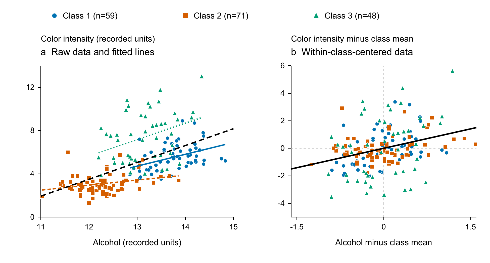
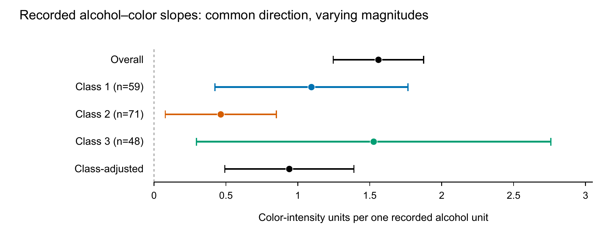
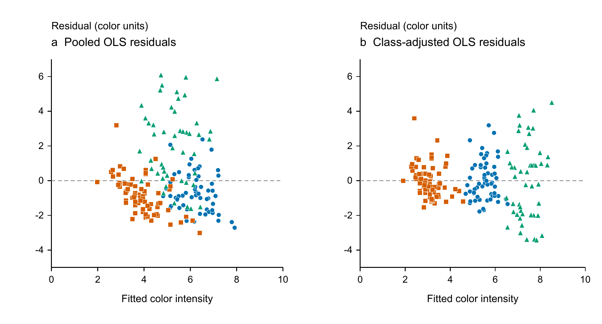

# Alcohol content and color intensity in the UCI Wine dataset

## Abstract
Alcohol content and color intensity were positively associated in the complete official UCI Wine dataset, but the pooled relationship was stronger than the relationship after accounting for cultivar class. We analyzed all 178 historical records using correlations and ordinary least squares, then compared three class-specific estimates with a model containing class-specific intercepts. Overall Pearson r was 0.546 and the slope was 1.560 color-intensity units per recorded alcohol unit (HC3 95% interval 1.246 to 1.875). All three class slopes were positive, ranging from 0.464 to 1.527. The class-adjusted common slope was 0.940 (0.492 to 1.389), with partial r of 0.319. Rank correlations and all single-record omission fits retained the positive direction. These results describe this dataset: they show directional consistency across classes, without establishing equal slopes, a causal effect of alcohol, or a population relationship.

## Introduction
A pooled association can combine differences between groups with relationships within groups. The Wine dataset provides a compact setting for examining this distinction because its chemical measurements are accompanied by three cultivar-class labels [1]. For a reader interpreting alcohol and color intensity, the relevant questions are therefore both the direction and magnitude of the overall relationship and whether that relationship remains within and after accounting for class. We address those questions on the complete official historical dataset. We do not test a new chemical mechanism or infer how changing alcohol would alter color.

## Methods
We obtained the original wine.data and wine.names files from the official UCI Wine archive on 18 October 2026 [1]. The dictionary describes wines from three cultivars grown in one Italian region. We parsed all 178 records and all 13 measured attributes plus the class label, confirming class counts of 59, 71, and 48. No values were missing or nonfinite, no complete rows were duplicated, and no records were excluded or imputed. Alcohol was the first feature and color intensity the tenth. The documentation did not supply measurement units, cultivar names, a probability sampling frame, collection dates, batch structure, or a replicate hierarchy; numeric class codes and recorded variable units were retained.

The first primary analysis estimated the overall Pearson correlation, Spearman correlation using average ranks for ties, and the ordinary least-squares slope from color intensity on alcohol with an intercept. We used every record and no training or testing split, because the target was a fixed-dataset descriptive relationship rather than predictive performance. Pearson intervals used the Fisher transformation and its normal approximation.

The second primary analysis estimated Pearson and Spearman correlations and separate slopes within each class. We then fit a model with alcohol and categorical class indicators, allowing different intercepts and a common slope. Correlating class-demeaned alcohol and color gave the partial correlation. An alcohol-by-class interaction model supplied separate slopes; a two-degree-of-freedom HC3 Wald diagnostic summarized slope heterogeneity. The common slope is a weighted average of the class slopes using within-class alcohol variation, rather than an assertion that slopes are identical.

Analyses were specified before the diagnostic pilot and formal fits. Slopes are color-intensity units per one recorded alcohol unit. We calculated HC3 heteroscedasticity-adjusted sandwich standard errors using residuals divided by one minus leverage [2], with normal-reference 95% intervals. These intervals summarize sensitivity under an independent-error regression model, not uncertainty about the complete observed dataset or verified coverage for a wine population. The interaction reference p value was descriptive; no threshold selected a result or established equivalence, and no family of confirmatory population tests was claimed.

Required sensitivity checks compared rank correlations and classical normal-reference intervals, omitted each record once from the pooled and adjusted models, added a squared class-centered alcohol term, and inspected residuals and influence. We independently reparsed the original data to reproduce the pooled slope by centered sums, the adjusted slope by class demeaning, and its HC3 standard error by a separate QR calculation. All computations used NumPy 2.3.5 and pandas 2.2.3; OLS coefficients were computed with NumPy least squares, and HC3 covariance matrices were evaluated from the design matrices, residuals, and leverage values. No stochastic fitting or data-driven exclusion was used.

## Results
Alcohol ranged from 11.03 to 14.83 (mean 13.001, SD 0.812), and color intensity from 1.28 to 13.00 (mean 5.058, SD 2.318). Class means for alcohol were 13.745, 12.279, and 13.154; corresponding color means were 5.528, 3.087, and 7.396. The raw scatter therefore contained both within-class variation and different class locations (Figure 1a).

The first primary analysis found an overall Pearson r of 0.546 (Fisher 95% interval 0.434 to 0.642) and Spearman rho of 0.635. The pooled slope was 1.560 (HC3 95% interval 1.246 to 1.875); the linear model accounted for 0.299 of the observed color-intensity variance. Thus, larger recorded alcohol values accompanied larger recorded color values overall, with considerable residual variation.

The second primary analysis found positive slopes and correlations in every class (Table 1). Class-specific slopes were 1.094, 0.464, and 1.527, whereas Pearson r values were 0.408, 0.270, and 0.350. The class-adjusted common slope was 0.940 (HC3 95% interval 0.492 to 1.389), about 40% smaller than the pooled slope, and the partial correlation was 0.319 (Figure 1b). The interaction diagnostic was chi-square 4.483 with 2 degrees of freedom (reference p = 0.106). The observed slope sizes differ; this diagnostic does not establish equal slopes (Figure 2).

Table 1. Descriptive associations on the full dataset. Slope intervals are HC3 normal-reference 95% intervals. The adjusted row uses the partial Pearson correlation; the dash indicates that this regression adjustment does not supply a Spearman coefficient. All slope units are color-intensity units per recorded alcohol unit.

| Analysis | n | Pearson r | Spearman rho | Slope | 95% interval |
|---|---|---|---|---|---|
| Overall | 178 | 0.546 | 0.635 | 1.560 | 1.246 to 1.875 |
| Class 1 | 59 | 0.408 | 0.443 | 1.094 | 0.423 to 1.765 |
| Class 2 | 71 | 0.270 | 0.257 | 0.464 | 0.078 to 0.850 |
| Class 3 | 48 | 0.350 | 0.284 | 1.527 | 0.295 to 2.759 |
| Class adjusted | 178 | 0.319 | - | 0.940 | 0.492 to 1.389 |

All 178 omission fits per model remained positive: pooled slopes ranged from 1.492 to 1.604, and adjusted slopes from 0.818 to 0.998. Classical normal-reference intervals were 1.207 to 1.914 overall and 0.525 to 1.356 after class adjustment, giving the same directional summary as HC3. The squared class-centered term was 0.014 (HC3 95% interval -0.652 to 0.680); this coarse check did not establish a nonlinear departure or prove linearity. Independent slope calculations differed from the formal values by at most 1.4 × 10^-15; the independent adjusted HC3 standard error differed by 3.4 × 10^-14. Residual plots showed greater remaining spread in class 3 (Supplementary Figure S1); maximum Cook distances were 0.099 overall and 0.140 adjusted. No observations were removed.

## Discussion
For these 178 records, the overall association is positive: Pearson r was 0.546 and the slope was 1.560. The positive direction also held within every class and after class adjustment. Directional consistency therefore survives the class comparison, while the smaller adjusted slope and partial correlation show that the pooled magnitude is not an adequate description of the within-class relationship.

Consistency in direction should not be read as consistency in size. Class 2 had the smallest fitted slope, and class 3 had the broadest slope interval. The common-slope model compresses this variation into a weighted summary. Its attenuation relative to the pooled model reflects the different covariance structure after class centering; it does not quantify a causal contribution of cultivar or prove that other sources of variation have been controlled. The positive direction was retained with rank correlations and after every single-record omission from the pooled and adjusted fits. These checks do not identify a mechanism.

The historical dataset was released for classification and provides limited information about sampling and measurement [1]. Unknown batch or repeated-measure structure prevents validating the independent-error interpretation of intervals; HC3 does not repair clustering, measurement error, or an incorrect mean model. Missing unit definitions also prevent translating slopes into a chemical intervention. The broad curvature interval and residual spread leave room for relationships more complex than straight lines. The results should remain descriptions of these records, without causal, population, or contemporary wine-production claims.

## Data and computation
The official Wine data are available under CC BY 4.0 [1]. The accompanying local materials contain the original archive, dictionary, parsed data, executed analysis and plotting code, full-precision results, and editable SVG figures. A Codex AI agent performed the computations and assisted with drafting. The accompanying code and full-precision outputs document the analyses. No new samples were collected.

## References
[1] Aeberhard S, Forina M. Wine [Dataset]. UCI Machine Learning Repository; 1992. https://doi.org/10.24432/C5PC7J. Original data and dictionary: https://archive.ics.uci.edu/static/public/109/wine.zip. Accessed 18 October 2026.

[2] statsmodels developers. OLSResults.HC3_se. Official statsmodels documentation. https://www.statsmodels.org/stable/generated/statsmodels.regression.linear_model.OLSResults.HC3_se.html. Accessed 18 October 2026. Cited for the HC3 formula; statsmodels software was not used in the calculations.

[2] statsmodels developers. OLSResults.HC3_se. Official statsmodels documentation. https://www.statsmodels.org/stable/generated/statsmodels.regression.linear_model.OLSResults.HC3_se.html. Accessed 18 October 2026. Cited for the HC3 formula; statsmodels software was not used in the calculations.

## Figures

Figure 1. Alcohol and color intensity in all 178 records. Panel a shows raw observations with class-specific OLS lines restricted to each class alcohol range and the pooled line in dashed black. Panel b subtracts the respective class means from both variables; the black line has the class-adjusted slope of 0.940. Blue circles, orange squares, and green triangles indicate classes 1, 2, and 3 (n = 59, 71, and 48). Axes use recorded units; lines are descriptive fits, with no uncertainty bands. Source: official UCI Wine data [1].

Figure 2. Slope magnitudes for the pooled, class-specific, and class-adjusted models. Points show fitted slopes and bars show HC3 normal-reference 95% intervals. All records are used in the pooled and adjusted models; class counts are shown in the labels. Intervals describe model-based sensitivity and do not establish population coverage or slope equivalence. No significance symbols are used.

## Supplementary results

Supplementary Figure S1. Actual residuals against fitted color intensity for pooled and class-adjusted OLS on all 178 records. Shapes and colors match Figure 1. Horizontal dashed lines mark zero residual. The unequal spread remaining across classes supports reporting HC3 sensitivity while retaining the unknown dependence and model limitations.
